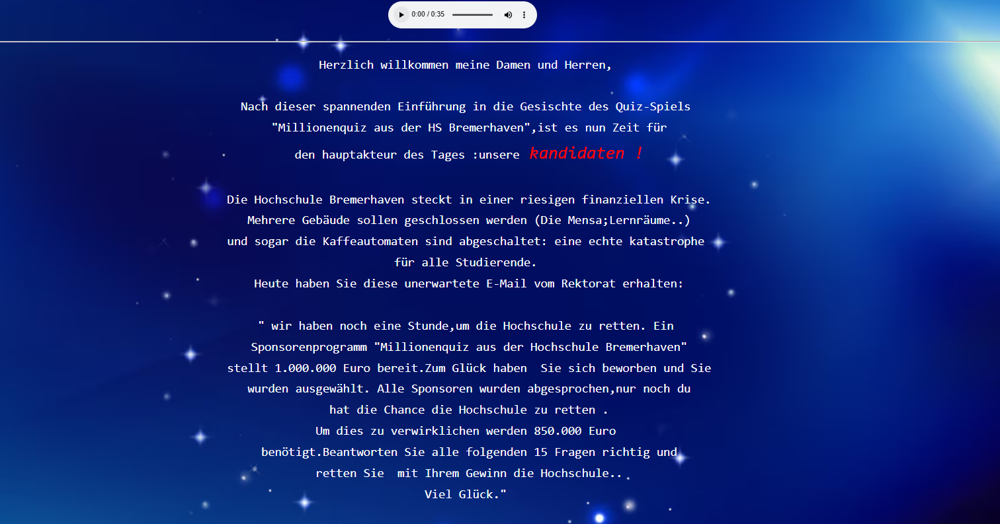
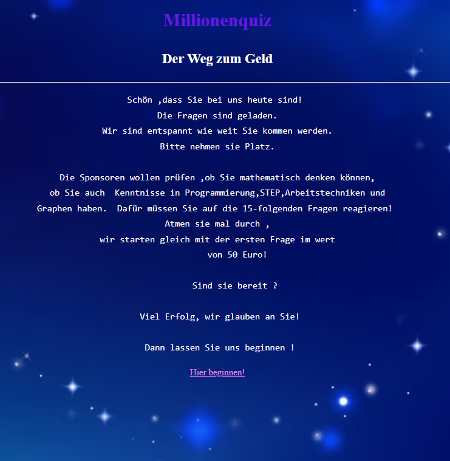
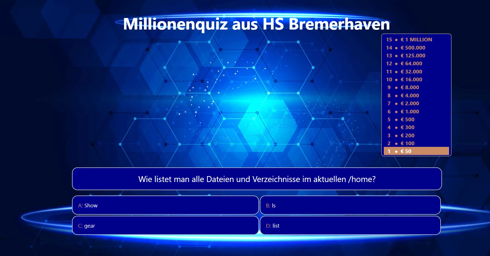
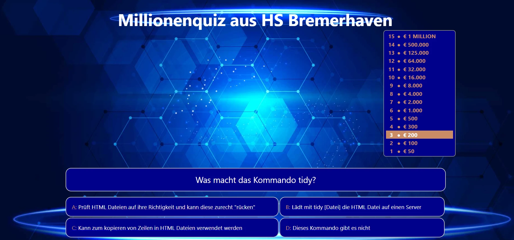
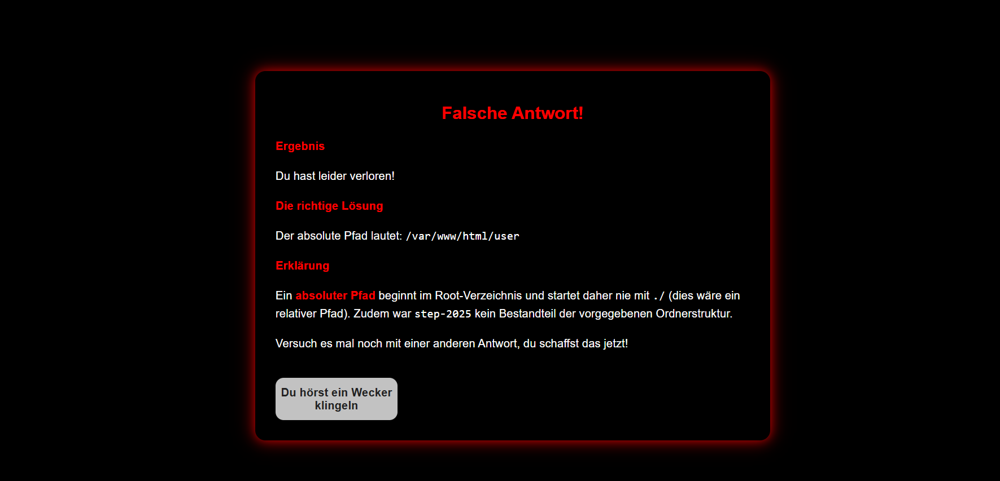
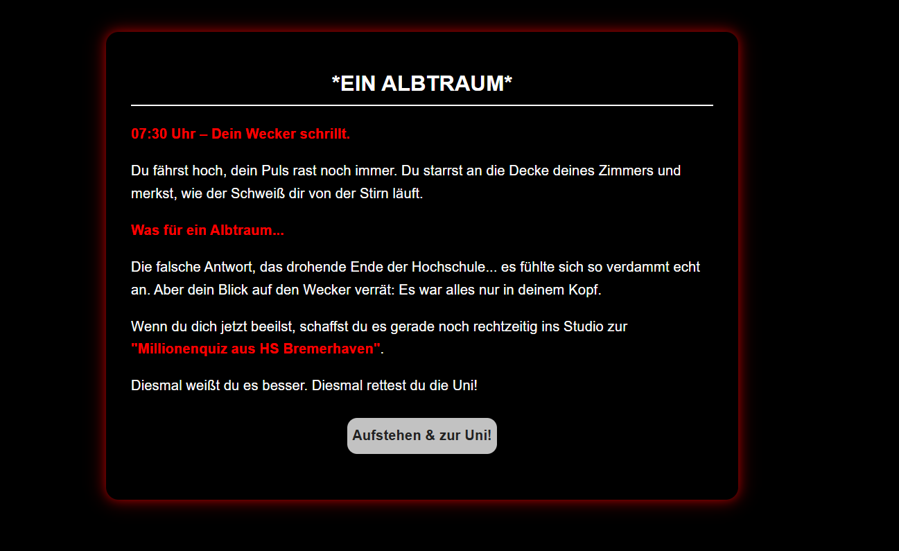

# Millionenquiz aus HS Bremerhaven

Ein Quiz-Spiel im Browser. Wir haben es im Team an der Hochschule Bremerhaven gemacht.
Es ist nur mit HTML und CSS gebaut.

Hier kannst du das Spiel direkt spielen: https://brunelleybgit.github.io/millionenquiz/

## Die Geschichte

Die Hochschule Bremerhaven hat kein Geld mehr. Die Mensa und die Lernräume sollen schließen
und sogar die Kaffeeautomaten sind aus. Du bekommst eine E-Mail vom Rektorat:
Du hast eine Stunde Zeit, um im Millionenquiz das Geld zu gewinnen und die Hochschule zu retten.



## So funktioniert das Spiel

Zuerst liest du die Geschichte und klickst auf weiter. Dann liest du die Bedingungen und das Spiel fängt an.



Es gibt 15 Fragen. Der Preis steigt von 50 Euro bis 1 Million.
Wenn deine Antwort richtig ist, kommst du zur nächsten Frage und das Geld wird mehr.
Ab Frage 13 gibt es Joker (50:50, Telefon und Publikum).





Wenn die Antwort falsch ist, kommt eine schwarze Seite mit rotem Rand. Dort steht die richtige Lösung und eine Erklärung.



Dann klickst du auf den Wecker und merkst, dass alles nur ein Albtraum war.
Jetzt fängt das Spiel erst richtig an und du kannst es noch einmal versuchen.



## Spielen

Online: https://brunelleybgit.github.io/millionenquiz/

Oder die Datei `index.html` im Browser öffnen. Sie geht direkt zur Startseite `Fragen/Seite.html`.

Die Musik und das Video sind nicht im Repo, weil wir die Rechte daran nicht haben.
Das Spiel geht aber auch ohne.

## Ordner

```
Fragen/      Startseite, Einleitung, die 15 Fragen und die Bilder
Infoseite/   Seiten für falsche Antworten, Wecker und Gewonnen
docs/        Bilder für dieses README
```

## Mein Teil

Wir waren ein Team. Ich habe die Geschichte erfunden und die Startseite und die zweite Seite gemacht,
damit das Spiel interaktiv wird. Außerdem habe ich die ersten 4 Fragen mit ihren Fehlerseiten gemacht.
